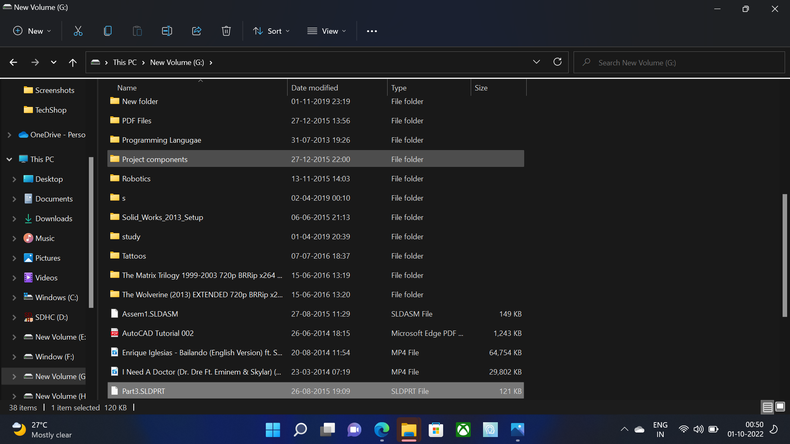

# Ping Pong Game

A simple Python ping pong game built with Turtle graphics.

## Features
- Player-controlled paddle (arrow keys)
- second-player opponent (wasd)
- Score tracking
- Ball movement and collisions

## Screenshot



## How to Run

```bash
python main.py
```

## Project Structure

- `main.py` - game entry point
- `ball.py` - ball logic
- `paddle.py` - paddle logic
- `scoreboard.py` - score display
- `assets/` - game screenshots and other static files

Have Fun! 